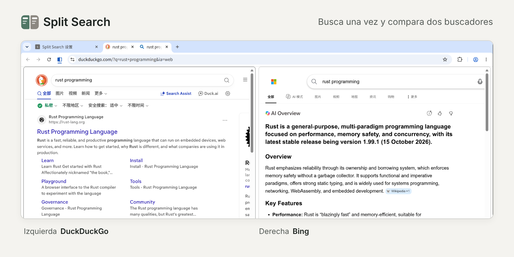

# Split Search

[English](README.md) | [简体中文](README.zh-CN.md) | [繁體中文](README.zh-TW.md) | **Español**

Busca en la barra de direcciones o arrastra texto a la barra de pestañas, y Split Search abrirá los resultados de dos buscadores en la vista dividida de Chrome, uno al lado del otro, para que los compares.

## Funciones

- Compara dos buscadores desde la barra de direcciones o arrastrando texto a la barra de pestañas. Elige tus buscadores, añade otros y crea varias combinaciones, cada una con su propio atajo
- Haz clic con el botón derecho en un texto seleccionado o en una imagen para buscarlo junto a la página que estás viendo
- Haz clic en el botón de la barra de herramientas para cambiar el buscador de la derecha sin volver a buscar
- El buscador de la derecha puede cambiar solo según lo que busques; por ejemplo, a YouTube cuando tu búsqueda contiene «video»

## Instalación

Requiere Chrome 155 o posterior.

**[Instalar desde Chrome Web Store](https://chromewebstore.google.com/detail/Split%20Search/ebefmgpipceocigodihbbbhdiagmjdak)**

Para instalarla a mano:

1. Descarga `split-search-<versión>.zip` desde [Releases](https://github.com/pine2D/split-search/releases/latest) y descomprímelo.
2. Abre `chrome://extensions`, activa el «Modo Desarrollador» («Modo de desarrollador») en la esquina superior derecha, haz clic en «Cargar descomprimida» («Cargar extensión sin empaquetar») y selecciona la carpeta descomprimida.
3. Al terminar la instalación, se abrirá automáticamente la configuración de Split Search.

Para actualizarla, descomprime la nueva versión en la misma carpeta y haz clic en «Volver a cargar» en la tarjeta de la extensión. Si usas otra carpeta, Chrome la trata como otra extensión y no conserva tu configuración.

## Configuración

Para probar Split Search, abre una página de resultados de Google, Bing u otro buscador de la extensión. Haz clic en Split Search en la barra de herramientas y elige otro buscador para comparar los resultados. Puedes mantener tu buscador predeterminado. Si prefieres probar un ejemplo, abre «Primeros pasos» en los ajustes, da acceso al buscador de la izquierda y haz clic en «Probar el ejemplo».

Para usar Split Search desde la barra de direcciones, añade una búsqueda en el sitio en Chrome.

1. Elige los dos buscadores en «Combinaciones» y abre «Añadir a Chrome». Si se te pide, da acceso al buscador de la izquierda. Copia la URL de la combinación y haz clic en «Abrir los ajustes de búsqueda de Chrome».
2. Junto a «Búsquedas en el sitio» («Búsqueda en sitios»), haz clic en «Añadir» («Agregar»). Escribe un nombre y un atajo (por ejemplo, `gb`), pega la URL en «URL con %s en el lugar de la consulta» («URL con %s en lugar de la consulta») y guarda la entrada.
3. Escribe el atajo en la barra de direcciones, pulsa Tab e introduce tu búsqueda. Si también quieres usar la combinación al buscar directamente o al arrastrar texto a la barra de pestañas, elige «Elegir como predeterminado» («Configurar como predeterminado») en el menú ⋮ de la entrada. Dejarás de ver las sugerencias de tu buscador habitual en la barra de direcciones.

## Ten en cuenta

- En «Combinaciones», puedes activar «Cerrar ambas pestañas al cerrar una» (desactivado de forma predeterminada). Se aplica a las vistas divididas de búsqueda creadas por esta extensión, incluso después de navegar a otra página. No afecta a las consultas del menú contextual ni a las pestañas contiguas en ventanas estrechas. Si separas una vista dividida y cierras una pestaña de inmediato, la otra también podría cerrarse.
- En las ventanas estrechas, los resultados se abren en pestañas contiguas de forma predeterminada. Al buscar desde la barra de direcciones o añadir otro buscador desde la barra de herramientas, el segundo resultado se abre en segundo plano. Si buscas texto o una imagen con el botón derecho, pasas a la pestaña del resultado.
- En ventanas de incógnito o en otros dispositivos, se hace una búsqueda normal.

## Privacidad

Lo que buscas solo llega a los buscadores que elijas, nunca al desarrollador ni a otros terceros. Split Search no usa servidores propios ni incluye estadísticas de uso ni publicidad. Para abrir la vista dividida, lee en tu dispositivo la URL de tu búsqueda y la de la pestaña actual, y no las guarda. Solo lee el texto seleccionado o la dirección de una imagen cuando usas su menú contextual. Tus búsquedas se guardan en la memoria del navegador y se borran al cerrarlo. Más información en la [política de privacidad](https://pine2d.github.io/split-search/privacy) (en inglés).
