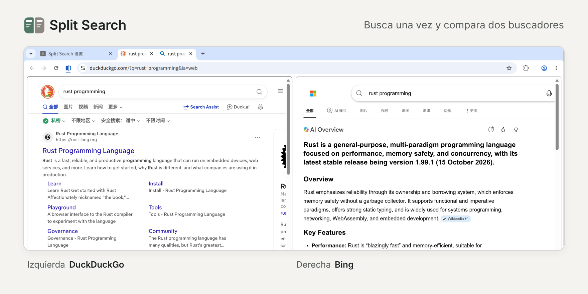

# Split Search

[English](README.md) | [简体中文](README.zh-CN.md) | [繁體中文](README.zh-TW.md) | **Español**

Busca en la barra de direcciones o arrastra texto a la barra de pestañas, y Split Search abrirá los resultados de dos buscadores en la vista dividida de Chrome, uno al lado del otro, para que los compares.

## Funciones

- Funciona al buscar en la barra de direcciones, al arrastrar texto a la barra de pestañas y con la opción «Buscar … en X» («Buscar “…” en X») del menú contextual.
- Incluye Google, Bing, DuckDuckGo, Perplexity y Kagi, y puedes añadir otros buscadores.
- Puedes crear varias combinaciones, cada una con su propio atajo. Por ejemplo, escribe «gb palabras clave» para comparar Google y Bing.
- Los dos lados son pestañas normales, así que conservas tus sesiones iniciadas y la configuración de cada sitio.

## Instalación

Requiere Chrome 155 o posterior.

1. Descarga este repositorio, abre `chrome://extensions` y activa el «Modo Desarrollador» («Modo de desarrollador») en la esquina superior derecha.
2. Haz clic en «Cargar descomprimida» («Cargar extensión sin empaquetar») y selecciona la carpeta `src` del repositorio.
3. Al terminar la instalación, se abrirá automáticamente la configuración de Split Search.

## Configuración

1. **Da acceso**: en la configuración de Split Search, haz clic en «Dar acceso» junto a cada buscador que vayas a usar.
2. **Copia la URL**: en «Combinación predeterminada», elige el buscador de la izquierda y el de la derecha. Luego copia la URL que aparece en «Añadir a Chrome».
3. **Añádela y elígela como predeterminada**: escribe `chrome://settings/searchEngines` en la barra de direcciones. En la sección «Búsquedas en el sitio» («Búsqueda en sitios»), haz clic en «Añadir» («Agregar»). En «Nombre», pon lo que quieras; en «Atajo», el que prefieras (por ejemplo, `gb`); en «URL con %s en el lugar de la consulta» («URL con %s en lugar de la consulta»), pega la URL que copiaste. Haz clic en «Añadir» («Agregar»). Por último, en el menú ⋮ a la derecha de esa entrada, selecciona «Elegir como predeterminado» («Configurar como predeterminado»).

Si solo quieres usar el atajo, no hace falta elegir la entrada como predeterminada: escribe «atajo + espacio + palabras clave» en la barra de direcciones. En ese caso, al arrastrar texto o buscar desde el menú contextual se sigue usando tu buscador predeterminado de siempre.

## Ten en cuenta

- En ventanas de incógnito, en otros dispositivos o si la extensión no está activa, se hace una búsqueda normal.
- Mientras uses Split Search como buscador predeterminado, la barra de direcciones no muestra sugerencias de búsqueda.

## Privacidad

Split Search no recopila ningún dato: no usa servidores propios ni incluye estadísticas de uso ni publicidad. Tus términos de búsqueda solo llegan a los dos buscadores que elijas. Más información en la [política de privacidad](https://pine2d.github.io/split-search/privacy) (en inglés).
