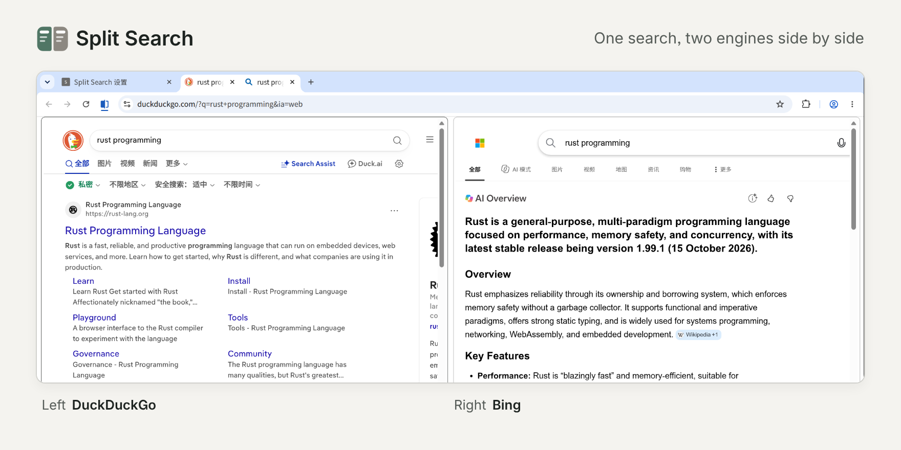

# Split Search

**English** | [简体中文](README.zh-CN.md) | [繁體中文](README.zh-TW.md) | [Español](README.es.md)

Search from the address bar or drag text to the tab strip, and Split Search opens results from two search engines side by side in Chrome’s split view, so you can compare them.

## Features

- Compare two engines from the address bar or by dragging text onto the tab strip. Pick your engines, add your own, and set up several pairs, each with its own shortcut
- Right-click selected text or an image to look it up next to the page you’re on
- Click the toolbar button to switch the right side to another engine without searching again
- The right-side engine can switch automatically by keyword, for example to YouTube when your search contains “video”

## Install

Requires Chrome 155 or later.

**[Install from the Chrome Web Store](https://chromewebstore.google.com/detail/Split%20Search/ebefmgpipceocigodihbbbhdiagmjdak)**

To install it manually:

1. Download `split-search-<version>.zip` from [Releases](https://github.com/pine2D/split-search/releases/latest) and unzip it.
2. Open `chrome://extensions`, turn on “Developer mode” in the top-right corner, click “Load unpacked” and select the unzipped folder.
3. The settings page opens automatically after installation.

To update, unzip the new version into the same folder and click “Reload” on the extension’s card. A different folder counts as a different extension, and your settings won’t carry over.

## Setup

To try it, open a results page from Google, Bing, or another engine in Split Search. Click Split Search in the toolbar and choose a second engine. You can keep your usual default search engine. To run an example instead, open “Get started” in settings, allow access to the left engine, and click “Run example search”.

To use Split Search from the address bar, add a site search in Chrome.

1. Choose the two engines under “Search pairs”, then open “Add to Chrome”. Allow access to the left engine if prompted, copy the pair’s URL, then click “Open Chrome search settings”.
2. Click “Add” next to “Site search”. Enter a name and a shortcut (for example, `gb`), paste the URL into “URL with %s in place of query”, and click “Add”.
3. Type the shortcut in the address bar, press Tab, then enter your search. To use the pair for ordinary searches and text dragged to the tab strip too, choose “Make default” from the entry’s ⋮ menu. This turns off your usual search engine’s suggestions in the address bar.

## Good to know

- On “Search pairs”, you can enable “Close both tabs when either one is closed” (off by default). It applies to search split views created by this extension, even after navigating to another page. Context-menu lookups and adjacent tabs in narrow windows are excluded. If you separate a split view and immediately close a tab, the other tab may still close with it.
- In narrow windows, results open in adjacent tabs by default. When you search from the address bar or add an engine from the toolbar, the second result opens in the background. Looking up text or an image from the context menu switches to the result tab.
- In Incognito windows or on other devices, you get a normal search.

## Privacy

What you look up goes only to the search engines you choose, never to the developer or any other third party. Split Search has no servers, analytics or ads. To open the split view, it reads your search URL and the current tab’s URL on your device and doesn’t store them. It reads selected text or an image’s address only when you use its right-click menu. Your searches are kept in browser memory and cleared when you close the browser. Read the [privacy policy](https://pine2d.github.io/split-search/privacy).
