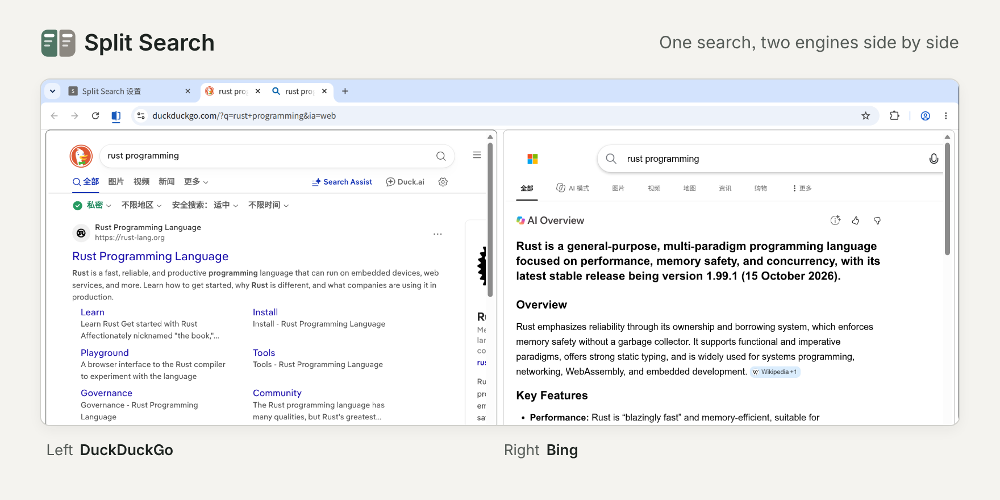

# Split Search

**English** | [简体中文](README.zh-CN.md) | [繁體中文](README.zh-TW.md) | [Español](README.es.md)

Search from the address bar or drag text to the tab strip, and Split Search opens results from two search engines side by side in Chrome’s split view, so you can compare them.

## Features

- Works from the address bar, from text dragged to the tab strip, and from the Search [engine] for “…” item in Chrome’s right-click menu
- Google, Bing, DuckDuckGo, Perplexity and Kagi are built in, and you can add other search engines
- Set up several engine pairs, each with its own shortcut. For example, type “gb your search” to compare Google and Bing
- Both sides are regular tabs, so you stay signed in and your site settings still apply

## Install

Requires Chrome 155 or later.

1. Download this repository, open `chrome://extensions` and turn on “Developer mode” in the top-right corner.
2. Click “Load unpacked” and select the `src` folder in the repository.
3. The settings page opens automatically after installation.

## Setup

1. **Grant access**: on the settings page, click “Grant access” for each engine you want to use.
2. **Copy the URL**: under “Default pair”, pick a left and a right engine, then copy the generated URL from “Add to Chrome”.
3. **Add it and make it default**: enter `chrome://settings/searchEngines` in the address bar. Under “Site search”, click “Add”. Enter any name and a shortcut of your choice (for example, `gb`), paste the URL you copied into “URL with %s in place of query” and click “Add”. Then open the ⋮ menu next to the new entry and choose “Make default”.

If you only want the shortcut, skip “Make default” and type “shortcut + space + search terms” in the address bar. Dragged text and right-click searches then still use your current default search engine.

## Good to know

- In Incognito windows, on other devices, or when the extension isn’t active, you get a normal search.
- After you choose “Make default”, the address bar no longer shows search suggestions.

## Privacy

Split Search collects no data. It has no servers, analytics or ads, and your search terms go only to the two search engines you chose. Read the [privacy policy](https://pine2d.github.io/split-search/privacy).
