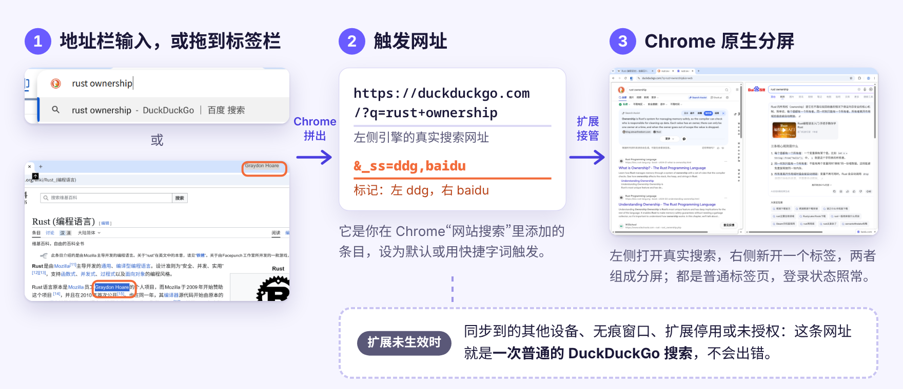

# Split Search

在地址栏输入关键词，或把文字拖到标签栏，直接用两个搜索引擎（如 Google 和 Bing）打开 Chrome 原生分屏，左右对比结果。两侧都是真实标签，保留各站登录状态。

## 环境要求

Chrome 155 或更高版本（需要原生分屏 API）。

## 安装

1. 打开 `chrome://extensions`，开启右上角“开发者模式”。
2. 点“加载已解压的扩展程序”，选择本项目的 `src` 目录。
3. 安装后会自动打开设置页。

## 三步上手

1. **授权**：在设置页给要用的搜索引擎点“授权”。
2. **复制触发网址**：选好左右两个引擎，复制生成的触发网址。
3. **添加并设为默认**：打开 `chrome://settings/searchEngines`，在“网站搜索”里添加，网址粘贴刚复制的内容，添加时填写快捷字词；如不想替换默认引擎，可不设为默认，改用“快捷字词 关键词”触发。

在其他设备或无痕窗口中，触发网址会退化为普通的左侧引擎搜索，不会出错。
