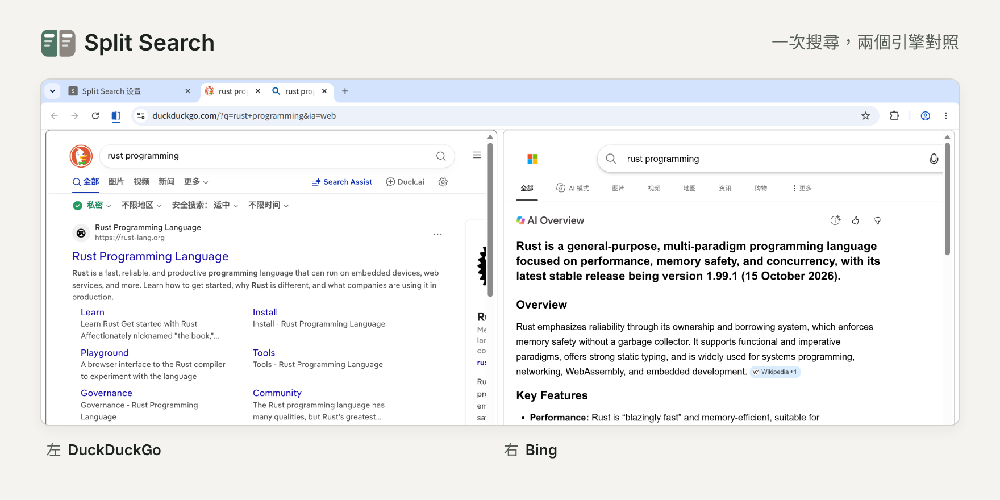

# Split Search

[English](README.md) | [简体中文](README.zh-CN.md) | **繁體中文** | [Español](README.es.md)

在網址列搜尋，或把文字拖曳到分頁列，Split Search 會用 Chrome 分割畫面左右開啟兩個搜尋引擎的結果，方便對照。

## 功能

- 網址列搜尋、把文字拖曳到分頁列、右鍵選單的「透過 X 搜尋『…』」都能使用
- 已經開啟某個引擎的搜尋結果頁時，點選工具列按鈕再選另一個引擎，就能和目前的網頁組成分割畫面
- 在網頁上選取文字後按右鍵，可以在分割畫面中查詢這段文字，目前的網頁會留在左邊
- 在圖片上按右鍵，可以用 Google Lens 等引擎以圖搜圖，結果會在目前網頁的旁邊開啟
- 內建 Google、Bing、DuckDuckGo、Perplexity、Kagi，也可以新增其他搜尋引擎
- 引擎庫收錄翻譯、百科、影片、地圖等適合放在右側的網站，也有 AI 助理，可以直接新增
- 可以設定多組引擎，各用一個搜尋捷徑，例如輸入「gb 關鍵字」對照 Google 和 Bing
- 點選工具列按鈕，就能把右側換成其他引擎，不必重新搜尋
- 也可以按快速鍵把右側換成下一個引擎。預設沒有設定快速鍵，請到 `chrome://extensions/shortcuts` 設定
- 視窗較窄時，右側會改在旁邊的背景分頁開啟，這項設定可以在設定頁關閉
- 兩側都是一般分頁，登入狀態和網站設定都不受影響

## 安裝

需要 Chrome 155 以上版本。

1. 下載這個儲存庫，前往 `chrome://extensions`，開啟右上角的「開發人員模式」。
2. 點選「載入未封裝項目」，選擇儲存庫裡的 `src` 資料夾。
3. 安裝完成後會自動開啟設定頁。

## 設定

第一次開啟設定頁時，頂端的「開始使用」卡片會一步步帶你完成下面的設定，最後還能直接試試看。

1. **授權**：在設定頁為要使用的搜尋引擎點選「授權」。
2. **複製網址**：在「預設組合」選好左右兩個引擎，到「新增到 Chrome」複製產生的網址。
3. **新增並設為預設**：在網址列開啟 `chrome://settings/searchEngines`，在「網站搜尋」區塊點選「新增」。「姓名」隨意填，「搜尋捷徑」自訂（例如 `gb`），把剛才複製的網址貼到「以 %s 取代查詢的網址」欄位，再點選「新增」。接著在這個項目右側的 ⋮ 選單中選「設為預設」。

只想用搜尋捷徑的話，可以不設為預設：在網址列輸入「搜尋捷徑 + 空格 + 關鍵字」即可。這時拖曳和 Chrome 內建的右鍵搜尋仍會使用原本的預設搜尋引擎。

## 注意事項

- 在無痕視窗、其他裝置上，或擴充功能沒有生效時，就只是一般搜尋。
- 設為預設後，網址列不會再顯示搜尋建議。
- 只有具備公開網址的圖片才能以圖搜圖，需要登入才能看到的圖片，引擎多半抓不到。

## 隱私

擴充功能不會把資料傳送給開發者或其他第三方，你要查詢的內容只會傳送給你選擇的引擎。擴充功能沒有伺服器，也不含統計分析和廣告。只有在你選了本擴充功能的右鍵選單項目時，才會讀取選取的文字或那張圖片的網址，不會讀取網頁網址或網頁上的其他內容。查詢內容和兩側的引擎只暫存在瀏覽器記憶體中，供彈出式視窗和快速鍵切換引擎，關閉瀏覽器就會清除。詳情請參閱[隱私權政策](https://pine2d.github.io/split-search/privacy)（英文）。
